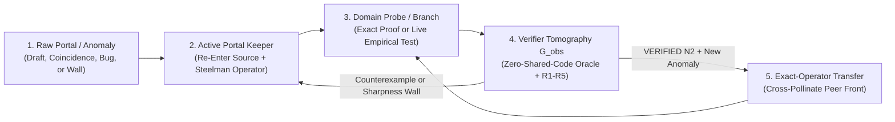

# Aletheia — Portal-Driven Scientific Discovery & Adversarial Verification Framework

> **Alētheia** (ἀλήθεια — *unconcealment*, stepping out of Plato's cave): an open, domain-general scientific discovery methodology, zero-dependency Python 3 CLI (`v1.2.0`), multi-platform agent adapter suite, and formal verification standard for human researchers and AI research swarms.
>
> **Law-4 Prior-Art & Naming Disambiguation:** Google DeepMind independently publishes a proprietary Gemini-Deep-Think mathematical proving agent named *Aletheia* (`google-deepmind/superhuman@9b620a9`, `aletheia/README.md` / `Aletheia.pdf`). **`Foundation-0/aletheia` is completely orthogonal:** an open-source (Apache-2.0), model-agnostic, zero-dependency anti-Cave research methodology, Beyond-Language coordinate-free protocol, and R1–R5 adversarial verification CLI.

Standard AI research workflows—and standard critique-first review loops—fall into a systematic **cave-shadow trap**: they treat rough ideas, messy transcripts, or buggy prototypes as finished papers to grade, catch implementation flaws, log clean negative results, and stall at **`N0` (no new ground)**. **The Aletheia Method** breaks out of that trap by coupling **radical open-mindedness in hypothesis generation** (*Active Portal Resonance* + *Steelman-Before-Falsify*) with **zero-mercy independence in certification** (*Active Multi-Basis Observer Tomography*, $\mathcal{G}_{\mathrm{obs}}$, across 9 verification gates and R1–R5 gate-integrity contracts).

---

## The Resonance Cavity



1. **Never park the Portal Keeper:** Raw sources, lab logs, and unfinished repos are *portals* to re-enter whenever an anomaly appears—not static filing cabinets indexed once.
2. **Perceive beyond language & beyond numerology (v1.2):** Strip disciplinary labels and base-10/coordinate numerology (*Stage A*), then distill raw relational geometry into coordinate-free, unit-free, radix-free exact invariants or zero-residual null-equivalences (*Stage B*, [`THEORY.md`](THEORY.md#35-beyond-language-beyond-numerology-structural-perception-v12)).
3. **Steelman before falsifying:** Separate prototype bugs from the underlying mathematical or physical invariant; test the strongest repaired statement before declaring a direction dead.
4. **Verify via independent multi-basis tomography ($\mathcal{G}_{\mathrm{obs}}$):** Zero shared code, strict `exact` / `sampled` / `anchor` oracle honesty, R1–R5 gate-integrity & mutation testing, and full-text prior-art verification before claiming `N1` or `N2`.

---

## Empirical Proof: The Cave Expedition Natural Experiment

Aletheia was not designed abstractly—it emerged from a live natural experiment during the November 2026 [Cave Expedition](https://github.com/Foundation-0/cave-expedition), where a single mid-flight directive switched the exact same swarm from static Pass-1 critique to active Portal-Driven Resonance (full audit trail in [`evidence/cave-expedition-case-study.md`](evidence/cave-expedition-case-study.md)):

| Dimension | **Pass 1 (`#10`–`#14`, Static Critique)** | **Pass 2+ (`#15`–`#100`, Aletheia Resonance)** |
|---|---|---|
| **Cartographer / Portal Role** | One-shot static map (`#10`–`#14`), then parked `[done]` | Active **Portal Keeper** re-entering raw sources on every anomaly (`#16`, `#25`, `#38`, `#46`, `#47`, `#52`, `#53`) |
| **Handling of Rough Drafts** | Cataloged bugs (`AUDIT-001` `FALSIFIED`, `AUDIT-003` `PARTIAL`) and stopped | Separated prototype defects from underlying invariants; steelmanned first, then certified in exact arithmetic |
| **Verifier Role** | Rejection gate only | **Active Tomography ($\mathcal{G}_{\mathrm{obs}}$):** caught `5/5` real intermediate defects (`AUDIT-006/007/013/015/020`), supplied minimal reproducers & sharpness walls, driving clean upgrades to `VERIFIED` |
| **Verified Yield (`AUDIT-001`–`021`)** | **`0` confirmed `N2`** (matching peer baseline *"New ground: still none"*) | **`10` confirmed `N2` breakthroughs** + **`1` `N1`/`N2`** + **`7` `N1` advances**, `14` clean-room verifier scripts, `0` unresolved defects, published across [2 canonical `Foundation-0` repos & 10 open Draft PRs](evidence/cave-expedition-case-study.md#4-complete-published-artifact-ledger) |

> **Provenance Standing:** Every cross-repo mathematical/physical contribution from the Cave Expedition remains an open Draft PR awaiting human and external peer review; "`VERIFIED`" and "`N2`" denote survival of our 9-gate clean-room adversarial protocol and full-text prior-art checks.

---

## 60-Second Quickstart

### 1. Run the 3-Second Live Resonance Demo (Zero Dependencies)

Experience a complete 5-stage Aletheia cycle—*Pass-1 forgery $\to$ Steelman $W\oplus W^\perp$ projection $\to$ Clean-room Faddeev–LeVerrier/Descartes tomography & sharpness wall $\to$ Higher-moment $R_{H4}$ breakthrough $\to$ R5 mutant catches*—in pure Python 3 stdlib:

```bash
git clone https://github.com/Foundation-0/aletheia.git
cd aletheia
python3 -I -O -B -W error examples/worked_resonance_cycle/run_demo.py
```

### 2. Run the Zero-Dependency `aletheia` v1.2 CLI & Self-Test Suite

```bash
# Run directly without installing (or: pip install -e .)
PYTHONPATH=. python3 -m aletheia --help

# Scaffold a new expedition workspace
PYTHONPATH=. python3 -m aletheia init /tmp/my-expedition --domain physics

# Audit any repo/expedition for R4 parity, bare asserts, CRLF, leaks, and hardened v1.2 Lean 4 purity
# (v1.2 adds --allow-project-import, --comparator-config, --pinned-manifest, multiline debug.skipKernelTC,
#  Lean 4.22 public/private/meta imports, .partial non-FP, and strict Gate-8 --prereg-check)
PYTHONPATH=. python3 -m aletheia audit-check . --lean-audit

# Run AST-based R5 refusal-site mutation testing (supports --work-root/--add-cwd, dict verdicts & accumulators)
PYTHONPATH=. python3 -m aletheia mutate path/to/verifier.py --work-root . --test-cmd "python3 -I -O -B path/to/tests.py"

# Diagnose all 11 Cave-Shadow relapse patterns (CS-01..CS-11, incl. truncation mirages, collision denominators & unit/radix fragility)
PYTHONPATH=. python3 -m aletheia diagnose /tmp/my-expedition

# Run the 5-gate anti-Goodhart, noise-immune, CS-08-capped autonomous ratchet demo (AUDIT-026R + AUDIT-023)
PYTHONPATH=. python3 -m aletheia ratchet --demo

# Run Plane-1 zone-canon-v0 manifest pinning, causal audit DAG & abios SYM-2P/2.0-rcp bridge (AUDIT-027)
PYTHONPATH=. python3 -m aletheia mde --demo

# Run Aletheia's own self-verification suite across all 3 R4 modes
python3 -I -B tests/run_all.py && python3 -I -O -B tests/run_all.py && python3 -I -B -W error tests/run_all.py
```

### 3. Deploy Aletheia Into Your Agent Platform

Aletheia ships native, drop-in adapters for every major coding and research environment (see [`adapters/README.md`](adapters/README.md)):

| Platform | One-Line Setup / Location |
|---|---|
| **Antigravity (AGY)** | Ready-to-use workspace plugin at [`.agents/plugins/aletheia-research/`](.agents/plugins/aletheia-research/) — or run `PYTHONPATH=. python3 -m aletheia install --target antigravity` |
| **Claude Code** | Copy [`adapters/claude-code/`](adapters/claude-code/) (`CLAUDE.md`, `.claude-plugin/plugin.json`, `/aletheia` command, `portal-keeper` & `verifier-tomography` subagents) |
| **OpenAI Codex** | Repo-root [`AGENTS.md`](AGENTS.md) or [`adapters/codex/AGENTS.md`](adapters/codex/AGENTS.md) |
| **Cursor** | Copy [`adapters/cursor/.cursor/rules/aletheia-research.mdc`](adapters/cursor/.cursor/rules/aletheia-research.mdc) |
| **Gemini CLI** | Copy [`adapters/gemini-cli/GEMINI.md`](adapters/gemini-cli/GEMINI.md) |
| **Any LLM / Human-AI Loop** | Use [`adapters/generic-llm/SYSTEM_PROMPT.md`](adapters/generic-llm/SYSTEM_PROMPT.md) + [`prompts/single-agent-loop.md`](prompts/single-agent-loop.md) |

---

## Repository Map

```text
aletheia/
├── README.md                                  # Front door, Resonance Cavity diagram, 60s quickstart & repo map
├── LICENSE                                    # Apache License 2.0
├── AGENTS.md                                  # Universal root rule file (Codex / Antigravity / AGENTS.md-compatible tools)
├── THEORY.md                                  # First-principles mathematical & epistemological treatise on Aletheia
├── CONTRIBUTING.md                            # Contributing Domain Packs, Oracles, Platform Adapters & Case Studies
├── pyproject.toml                             # Zero-dependency PEP 621 Python 3 stdlib package config
├── spec/
│   └── LAWS_AND_GATES.md                      # Canonical v1.2 spec: 5 Laws, 9 Gates, R1–R5, CS-01..CS-11, Beyond-Language, MDE & Ratchet
├── evidence/
│   ├── cave-expedition-case-study.md          # Wave 1 empirical case study (Pass 1 vs Pass 2+, 5 chains, AUDIT-001..021)
│   ├── symbiosis-wave2-case-study.md          # Wave 2 Rounds 1–2 symbiosis across 30+ repos & v1.0->v1.1 (AUDIT-023..034R)
│   └── symbiosis-round3-10labs-case-study.md  # Wave 2 Round 3 10-lab epistemic web, Beyond-Language & v1.2 (AUDIT-035..039)
├── aletheia/                                  # Executable Python 3 stdlib CLI v1.2 (init, audit-check, mutate, diagnose, ratchet, mde, handoff, install)
├── tests/                                     # Self-verifying stdlib test & R5 mutation suite (tests/run_all.py)
├── examples/
│   └── worked_resonance_cycle/                # 3-second zero-float executable demo of a full Aletheia breakthrough cycle
├── domains/                                   # 6 practitioner Domain Adaptation Packs + Rosetta Stone index (domains/README.md)
│   ├── mathematics-and-formal-proof.md
│   ├── theoretical-and-computational-physics.md
│   ├── biology-and-life-sciences.md
│   ├── computer-science-and-systems.md
│   ├── materials-geometry-and-engineering.md
│   └── empirical-data-and-complex-systems.md
├── prompts/                                   # 8 modular role & workflow prompt templates (coordinator, portal-keeper, verifier, etc.)
├── schemas/                                   # JSON Schemas (draft/2020-12): audit_receipt, frontier_portal, compute_handoff
├── adapters/                                  # Drop-in adapters for Antigravity, Claude Code, Codex, Cursor, Gemini CLI & Generic LLMs
├── .agents/plugins/aletheia-research/         # Native Antigravity workspace plugin bundle
└── .github/workflows/aletheia-ci.yml          # Self-verifying CI across -I -B, -I -O -B, -I -B -W error
```

---

## Related Repositories

- **[`Foundation-0/cave-expedition`](https://github.com/Foundation-0/cave-expedition)** — Complete empirical archive of the inaugural expedition (`cartography/`, `peer-web/`, `verification/checks/check_001`–`check_014`, `AUDIT_LOG.md`, and Wave 2+ compute handoff).
- **[`Foundation-0/spectral-inertia`](https://github.com/Foundation-0/spectral-inertia)** — Flagship standalone theorem & certifier package (`AUDIT-002`, `014`, `015R`, `016R`) born directly from Aletheia's Chain 1 resonance cycle.

---

## License

Licensed under the [Apache License, Version 2.0](LICENSE).
