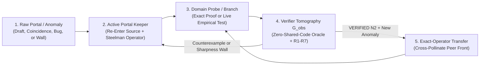

# Aletheia — Portal-Driven Scientific Discovery & Adversarial Verification Framework

**Start here:** [foundation-0.github.io/aletheia](https://foundation-0.github.io/aletheia/) · [Method](https://foundation-0.github.io/aletheia/method/) · [Joint map](https://foundation-0.github.io/aletheia/joint-map/) · [Start](https://foundation-0.github.io/aletheia/start/) · Twin site: [Cave Expedition](https://foundation-0.github.io/cave-expedition/)

Aletheia helps people and AI agents search for new results without fooling themselves. It keeps a rough idea alive long enough to find the sound claim inside it. Then it checks that claim with independent code before anyone calls it new.

The method and its first field test were born in the same run. The field test is the [Cave Expedition](https://github.com/Foundation-0/cave-expedition). Its ledger backs every claim on the site. Its outside check cut several early claims down. Those cuts are in this spec as Gates 9 and 10 and Law 2b.

> **Alētheia** (ἀλήθεια — *unconcealment*, stepping out of Plato's cave): an open, domain-general scientific discovery methodology, zero-dependency Python 3 CLI (`v2.1.0`), multi-platform agent adapter suite, and formal verification standard (`R1`–`R7`, Own-Terms-First, Law 2b Transformational Steelman) for human researchers and AI research swarms.
>
> **Law-4 Prior-Art & Naming Disambiguation:** Google DeepMind independently publishes a proprietary Gemini-Deep-Think mathematical proving agent named *Aletheia* (`google-deepmind/superhuman@9b620a9`, `aletheia/README.md` / `Aletheia.pdf`). **`Foundation-0/aletheia` is completely orthogonal:** an open-source (Apache-2.0), model-agnostic, zero-dependency anti-Cave research methodology, Own-Terms-First & Transformational Steelman protocol, and `R1`–`R7` adversarial verification CLI.

Standard AI research workflows—and standard critique-first review loops—fall into a systematic **cave-shadow trap**: they treat rough ideas, messy transcripts, or buggy prototypes as finished papers to grade, catch implementation flaws, log clean negative results, and stall at **`N0` (no new ground)**. **The Aletheia Method** breaks out of that trap by coupling **radical open-mindedness in hypothesis generation** (*Active Portal Resonance* + *Own-Terms-First* + *Steelman & Law 2b Transformational Steelman*) with **zero-mercy independence in certification** (*Active Multi-Basis Observer Tomography*, $\mathcal{G}_{\mathrm{obs}}$, across 10 verification gates and `R1`–`R7` gate-integrity contracts).

---

## The Resonance Cavity



1. **Never park the Portal Keeper:** Raw sources, lab logs, and unfinished repos are *portals* to re-enter whenever an anomaly appears—not static filing cabinets indexed once.
2. **Perceive beyond language & beyond numerology (v1.2):** Strip disciplinary labels and base-10/coordinate numerology (*Stage A*), then distill raw relational geometry into coordinate-free, unit-free, radix-free exact invariants or zero-residual null-equivalences (*Stage B*, [`THEORY.md`](THEORY.md#35-beyond-language-beyond-numerology-structural-perception-v12)).
3. **Steelman before falsifying:** Separate prototype bugs from the underlying mathematical or physical invariant; test the strongest repaired statement before declaring a direction dead.
4. **Verify via independent multi-basis tomography ($\mathcal{G}_{\mathrm{obs}}$):** Zero shared code, strict `exact` / `sampled` / `anchor` oracle honesty, R1–R7 gate-integrity contracts (R5 mutation testing, R6 pinned checks, R7 measured-not-declared values), and full-text prior-art verification before claiming `N1` or `N2`.

---

## Empirical Proof: The Cave Expedition Natural Experiment

Aletheia was not designed abstractly—it emerged from a live natural experiment during the November 2026 [Cave Expedition](https://github.com/Foundation-0/cave-expedition), where a single mid-flight directive switched the exact same swarm from static Pass-1 critique to active Portal-Driven Resonance (full audit trail in [`evidence/cave-expedition-case-study.md`](evidence/cave-expedition-case-study.md)):

| Dimension | **Pass 1 (`#10`–`#14`, Static Critique)** | **Pass 2+ (`#15`–`#100`, Aletheia Resonance)** |
|---|---|---|
| **Cartographer / Portal Role** | One-shot static map (`#10`–`#14`), then parked `[done]` | Active **Portal Keeper** re-entering raw sources on every anomaly (`#16`, `#25`, `#38`, `#46`, `#47`, `#52`, `#53`) |
| **Handling of Rough Drafts** | Cataloged bugs (`AUDIT-001` `FALSIFIED`, `AUDIT-003` `PARTIAL`) and stopped | Separated prototype defects from underlying invariants; steelmanned first, then certified in exact arithmetic |
| **Verifier Role** | Rejection gate only | **Active Tomography ($\mathcal{G}_{\mathrm{obs}}$):** caught `5/5` real intermediate defects (`AUDIT-006/007/013/015/020`), supplied minimal reproducers & sharpness walls, driving clean upgrades to `VERIFIED` |
| **Verified Yield (`AUDIT-001`–`021`)** | **`0` confirmed `N2`** (our sibling team's ledger read *"New ground: still none"* after its own critique-first pass on overlapping sources) | Ten results were labelled `N2` by the expedition's own verifier (plus `1` `N1`/`N2` and `8` `N1` advances across `14` verifier scripts; `0` unresolved defects in the results checked, with two check scripts `check_007`/`check_008` later needing re-pinning against patched heads). An independent two-pass outside check (`cave-expedition#4`) confirmed every central computation it covered, kept one at `N2` (`F_8 -> E_8` fold, medium confidence) and one as a strong candidate (all-$n$ `D_n` fold), and reclassified the rest to `N1` or `N0` after finding the same mechanisms under other fields' names. Published across [2 canonical `Foundation-0` repos & 10 open Draft PRs](evidence/cave-expedition-case-study.md#4-complete-published-artifact-ledger). |

> **Provenance Standing:** Every cross-repo mathematical/physical contribution from the Cave Expedition remains an open Draft PR awaiting human and external peer review; internal "`VERIFIED`" and "`N2`" tags denote survival of our verification protocol and full-text checks of the cited prior work. An outside check (`cave-expedition#4`, `evidence/outside/`) found several of the same mechanisms under other fields' names—directly driving v2.0's Gate 9 Mechanism-First Prior Art and Gate 10 Advocate Pass.

---

## 60-Second Quickstart

### 1. Run the 3-Second Live Resonance Demo (Zero Dependencies)

Experience a complete 5-stage Aletheia cycle—*Pass-1 forgery $\to$ Steelman $W\oplus W^\perp$ projection $\to$ Clean-room Faddeev–LeVerrier/Descartes tomography & sharpness wall $\to$ Higher-moment $R_{H4}$ breakthrough $\to$ R5 simulated-mutant catches*—in pure Python 3 stdlib:

```bash
git clone https://github.com/Foundation-0/aletheia.git
cd aletheia
python3 -I -O -B -W error examples/worked_resonance_cycle/run_demo.py
```

### 2. Run the Zero-Dependency `aletheia` v2.1.0 CLI & Self-Test Suite

```bash
# Run directly without installing (or: pip install -e .)
PYTHONPATH=. python3 -m aletheia --help

# Scaffold a new expedition workspace
PYTHONPATH=. python3 -m aletheia init /tmp/my-expedition --domain physics

# Audit a repo/expedition for R4 3-mode parity (incl. unittest -O skip detection), bare asserts,
# strict JSON/JSONL, CRLF, leaks, --strict-ancestors, and Lean 4 purity (self-audit of this repo):
PYTHONPATH=. python3 -m aletheia audit-check . --strict-ancestors

# Run pure-Q v2.0 gate-contract self-test (R6/R7, Two-Direction R3, NOT_SHOWN, Gate-8 col(Phi) latch, Law 2b, Own-Terms-First)
PYTHONPATH=. python3 -m aletheia gate-v2 --self-test --json

# Run deterministic static agent safety-surface scan (CYA-GAP-01..06) on package code
# (add --safety-scan to audit-check on target repos; scanning this repo's docs/tests flags their quoted test patterns by design):
PYTHONPATH=. python3 -m aletheia safety-scan aletheia --json

# Run AST-based R5 refusal-site mutation testing (local + cross-module imported wrappers, --guards,
# string/tuple/multi-stmt refusal shapes, self-check mode, NOT_SHOWN on truncation)
PYTHONPATH=. python3 -m aletheia mutate path/to/verifier.py --work-root . --add-cwd --max-mutants 0 --test-cmd "python3 path/to/tests.py"

# Diagnose all 12 automated Cave-Shadow relapse patterns (CS-01..CS-12, incl. root frontier_portals.md & --portals-path)
PYTHONPATH=. python3 -m aletheia diagnose /tmp/my-expedition

# Run the 5-gate anti-Goodhart, noise-immune, CS-08-capped autonomous ratchet demo (AUDIT-026R + AUDIT-023)
PYTHONPATH=. python3 -m aletheia ratchet --demo

# Run Plane-1 zone-canon-v0 manifest pinning, causal audit DAG & abios SYM-2P/2.0-rcp bridge (AUDIT-027)
PYTHONPATH=. python3 -m aletheia mde --demo

# Run the 8-Glyph Aletheia Operator Calculus (⧄ ⧅ ⦷ ⟠ ⧇ ⦺ ⩩ ⫩; reported 0 / 227,540 Lean 4 collisions, not reproduced here, AUDIT-051)
PYTHONPATH=. python3 -m aletheia calculus --list --json
PYTHONPATH=. python3 -m aletheia calculus --eval "⦺(L_odd ⦷ chi1) ⩩ (1, 2, 1)" --json
PYTHONPATH=. python3 -m aletheia calculus --self-test --json

# Machine-check the claims this repo and Foundation-0/cave-expedition make about each other
PYTHONPATH=. python3 -m aletheia twin-check --aletheia-root . --cave-root ../cave-expedition --json

# Run Aletheia's own self-verification suite across all 3 R4 modes
python3 -I -B tests/run_all.py && python3 -I -O -B tests/run_all.py && python3 -I -B -W error tests/run_all.py
```

### 3. Deploy Aletheia Into Your Agent Platform

Aletheia ships native, drop-in adapters for every major coding and research environment (see [`adapters/README.md`](adapters/README.md)):

| Platform | One-Line Setup / Location |
|---|---|
| **Antigravity (AGY)** | Ready-to-use workspace plugin at [`.agents/plugins/aletheia-research/`](.agents/plugins/aletheia-research/) — or run `PYTHONPATH=. python3 -m aletheia install --target antigravity` |
| **Claude Code** | Copy [`adapters/claude-code/`](adapters/claude-code/) (`CLAUDE.md`, `.claude-plugin/plugin.json`, `/aletheia` command, `portal-keeper` & `verifier-tomography` subagents) |
| **OpenAI Codex** | Repo-root [`AGENTS.md`](AGENTS.md) or [`adapters/codex/AGENTS.md`](adapters/codex/AGENTS.md) |
| **Cursor** | Copy [`adapters/cursor/.cursor/rules/aletheia-research.mdc`](adapters/cursor/.cursor/rules/aletheia-research.mdc) |
| **Gemini CLI** | Copy [`adapters/gemini-cli/GEMINI.md`](adapters/gemini-cli/GEMINI.md) |
| **Any LLM / Human-AI Loop** | Use [`adapters/generic-llm/SYSTEM_PROMPT.md`](adapters/generic-llm/SYSTEM_PROMPT.md) + [`prompts/single-agent-loop.md`](prompts/single-agent-loop.md) |

---

## Repository Map

```text
aletheia/
├── README.md                                  # Front door, Resonance Cavity diagram, 60s quickstart & repo map
├── LICENSE                                    # Apache License 2.0
├── AGENTS.md                                  # Universal root rule file (Codex / Antigravity / AGENTS.md-compatible tools)
├── THEORY.md                                  # First-principles mathematical & epistemological treatise on Aletheia
├── CONTRIBUTING.md                            # Spec-change process, reviewer/automated-authorship disclosure & pre-PR checks
├── CHANGELOG.md                               # Versioned release history (v1.4.0 -> v2.1.0)
├── pyproject.toml                             # Zero-dependency PEP 621 Python 3 stdlib package config (v2.1.0)
├── spec/
│   ├── LAWS_AND_GATES.md                      # Canonical v2.0 spec: Laws 1–5 + Law 2b, Own-Terms-First, 10 Gates, R1–R7, CS-01..CS-14
│   ├── proposals/OWN_TERMS_FIRST.md           # Own-Terms-First rule (direction confirmed 2026-11-22 in d43cb1c7; adopted in v2.0.0) + OTF-TIGHT-01..05
│   └── twin_contract.json                      # Pinned claims this repo and cave-expedition make about each other (aletheia twin-check)
├── evidence/
│   ├── outside/README.md                      # Permanent index of external audits & two-pass Advocate rulings
│   ├── cave-expedition-case-study.md          # Wave 1 empirical case study (Pass 1 vs Pass 2+, 5 chains, AUDIT-001..021)
│   ├── symbiosis-wave2-case-study.md          # Wave 2 Rounds 1–2 symbiosis across 30+ repos & v1.0->v1.1 (AUDIT-023..034R)
│   ├── symbiosis-round3-10labs-case-study.md  # Wave 2 Round 3 10-lab epistemic web, Beyond-Language & v1.2 (AUDIT-035..039)
│   ├── symbiosis-round4-ramanujan-hawking-case-study.md  # Wave 2 Round 4 Ramanujan/Hawking, Operator Calculus & v1.3 (AUDIT-041..054)
│   └── symbiosis-round6-warp-drive-case-study.md         # Wave 2 Round 6 Moissanite-Labs/warp-drive 5-arm audit & v1.4 (AUDIT-061R..065)
├── aletheia/                                  # Executable Python 3 stdlib CLI v2.1.0 (init, audit-check, mutate, diagnose, gate-v2, safety-scan, ratchet, mde, calculus, handoff, install, twin-check)
├── tests/                                     # Self-verifying stdlib test & R5 mutation suite (tests/run_all.py, test_gates_v2_r5.py, test_safety_r5.py, test_audit_walk_fail_closed.py, test_twin_check.py)
├── examples/
│   └── worked_resonance_cycle/                # 3-second zero-float executable demo of a full Aletheia breakthrough cycle
├── domains/                                   # 6 practitioner Domain Adaptation Packs + Rosetta Stone index (domains/README.md)
│   ├── mathematics-and-formal-proof.md
│   ├── theoretical-and-computational-physics.md
│   ├── biology-and-life-sciences.md
│   ├── computer-science-and-systems.md
│   ├── materials-geometry-and-engineering.md
│   └── empirical-data-and-complex-systems.md
├── prompts/                                   # 8 modular role & workflow prompt templates (coordinator, portal-keeper, verifier, etc.)
├── schemas/                                   # JSON Schemas (draft/2020-12): audit_receipt, frontier_portal, compute_handoff
├── adapters/                                  # Drop-in adapters for Antigravity, Claude Code, Codex, Cursor, Gemini CLI & Generic LLMs
├── .agents/plugins/aletheia-research/         # Native Antigravity workspace plugin bundle
├── docs/                                      # GitHub Pages site (foundation-0.github.io/aletheia), twin of cave-expedition site
└── .github/workflows/aletheia-ci.yml          # Self-verifying CI across -I -B, -I -O -B, -I -B -W error
```

---

## Related Repositories

- **[`Foundation-0/cave-expedition`](https://github.com/Foundation-0/cave-expedition)** — Complete empirical archive of the inaugural expedition (`cartography/`, `peer-web/`, `verification/checks/`, `AUDIT_LOG.md`, and Wave 2+ compute handoff).
- **[`Foundation-0/spectral-inertia`](https://github.com/Foundation-0/spectral-inertia)** — Flagship standalone theorem & certifier package (`AUDIT-002`, `014`, `015R`, `016R`) born directly from Aletheia's Chain 1 resonance cycle.
- **[`Foundation-0/hawking`](https://github.com/Foundation-0/hawking/pull/1)** — Exact zero-float horizon Schur/Krein, $p$-adic BTZ, MDR, and confirmed `N2` Boundary Double-Schur / Surgical-Severing suite (`AUDIT-041`–`043`, `047R`).
- **[`Foundation-0/ramanujan`](https://github.com/Foundation-0/ramanujan/pull/1)** — Zero-dependency exact verification suite for Ramanujan graphs, mock modular shadows, $PGL(2,\mathbb{Q}[[q]])$ / Mellin equalizers, and cross-org synthesis (`AUDIT-044`–`046`, `048R`).

---

## License

Licensed under the [Apache License, Version 2.0](LICENSE).
